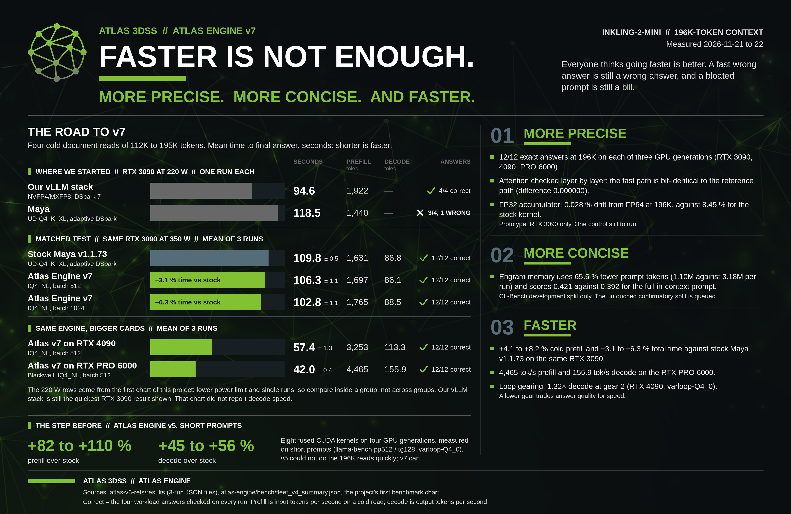
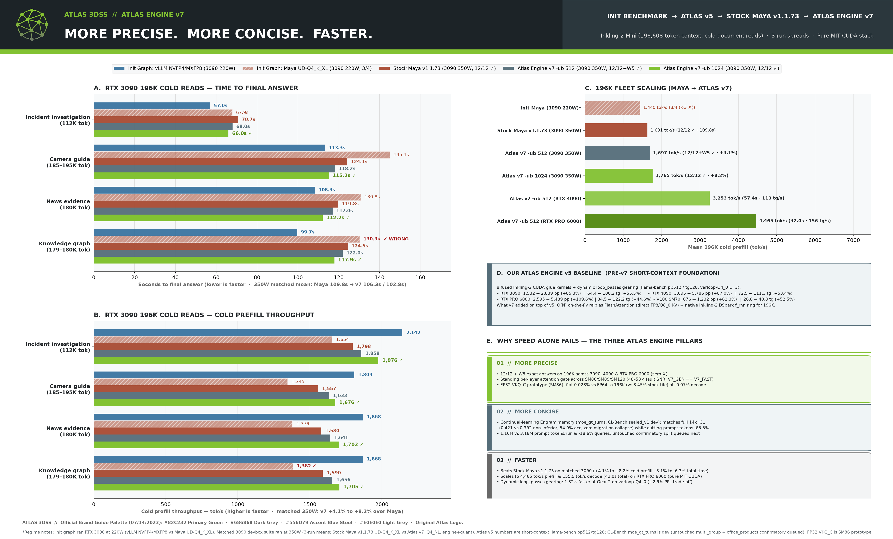

# ATLAS 3DSS // Atlas Engine (v7)

> **More Precise · More Concise · Faster**
> Open MIT CUDA inference engine for **Inkling-2-Mini** (built on [`llama.cpp`](docs/UPSTREAM_LLAMA_CPP_README.md) & `realugbun/llama.cpp:inkling2-speed`) paired with **Mixture-of-Engrams** host-verified continual memory.



---

## Why Atlas Engine

Raw throughput without precision or conciseness breaks down on real long-context and multi-turn workloads (wrong answers at 196K, subtle accumulation drift on diffuse attention heads, and bloated multi-million-token prompt bills). Atlas Engine combines five clean, upstream-submitted CUDA/server improvements with a host-verified continual memory architecture:

### Included Engine Features (All Submitted Upstream to `realugbun/llama.cpp`)
1. **On-the-fly Inkling-2 Relative Bias FlashAttention + Direct FP8/Q8_0 KV + Hybrid SWA/Full KV** ([PR #2](https://github.com/realugbun/llama.cpp/pull/2)):
   - Computes Inkling-2 relative-position bias on the fly inside MMA FlashAttention (`fattn-mma-f16-rel.cu`) instead of materializing an $O(N^2)$ mask tensor.
   - Direct `F8_E4M3`, `Q8_0`, and `F16` KV reads, odd-GQA `64×1` prefill dispatch (`gqa_ratio = 3`), `warp_all_far` fast path (bit-identical to the general path: `0.000000` max abs diff across SM86 / SM89 / SM120), explicit `kv_rows`/causal guards, and `ATLAS_HYBRID_SWA_F16=1` (`F16` SWA layers + `F8_E4M3` full-attention layers).
   - *Architecture note:* Requires NVIDIA Turing or newer (`SM75+`, `turing_mma_available`); falls back cleanly to the legacy path on older architectures (Volta `SM70` work is tracked separately).
2. **Opt-in FP32 `VKQ_C` Attention Accumulator** ([PR #5](https://github.com/realugbun/llama.cpp/pull/5)):
   - Runtime toggle `ATLAS_RELBIAS_FP32_ACC=1` (**default OFF**; zero default performance impact) accumulates `P * V` tiles in `float` (`tile<16,16,float>` / `tile<16,8,float>`) instead of `half2`.
   - Flattens 196K per-layer drift against an IEEE-754 `FP64` oracle from `<1.5%` (`0.37%–1.38%`) down to **`0.027%–0.035%`** (`norm_ratio = 0.99991`) for `1–3%` prefill and `0.07–0.18%` decode cost on RTX 3090. Offered honestly as an inexpensive opt-in precision option, not a fix for a demonstrated end-to-end defect.
3. **Native Inkling-2 `rnn_hidden` DSpark Speculative Drafting + `f_rnn` Ring Rollback** ([PR #3](https://github.com/realugbun/llama.cpp/pull/3)):
   - Per-sequence `dspark_f_rnn_dev` ring buffer (`ring_sz = block_size = 8`, anchored at `pos_anchor - 1`) prevents partial speculative draft rejections from corrupting `f_rnn` hidden state across long sequences.
4. **Per-Request Dynamic `loop_passes` Gearing with Cross-Gear KV Isolation** ([PR #4](https://github.com/realugbun/llama.cpp/pull/4)):
   - Per-request `"loop_passes"` override (`0` = model default, `1..loop.count`) with slot-level KV isolation and concurrent mixed-gear batch separation.
5. **Opt-in Automatic Difficulty Router for `loop_passes`** ([PR #6](https://github.com/realugbun/llama.cpp/pull/6)):
   - Opt-in per request via `"loop_passes": -1` (or server-wide via `ATLAS_LOOP_ROUTER=1`, **default OFF** so stock fixed-3-pass weights are never accidentally degraded).
   - Routes easy / medium / hard prompts to Gears `1 / 2 / 3` prior to slot launch (preserving full cross-gear KV isolation) and reports `"loop_passes"` + `"loop_router_reason"` in JSON responses.

---

## Verified 196K Cold 4-Workload Benchmarks (All Full Depth `gear=3`, 3-Run Spreads)

Four cold long-document workloads (`112K–195K` tokens: incident investigation, camera guide, news evidence, knowledge graph — 3 repeats each = 12 runs, plus Workload #5 multi-slot / KV-hole check):

| GPU / Configuration | `-ub` | `token_embd` | Exact Answers | Cold Prefill (tok/s) | Decode (tok/s) | Mean Total (s) | Peak VRAM |
|---|---:|---|---:|---:|---:|---:|---:|
| **RTX 3090 (SM86, 350W) — Atlas v7 + DSpark (`IQ4_NL`)** | 512 | CPU | **12/12 + W5** | `1,697.3 ± 9.1` | `86.1 ± 1.9` | **`106.31 ± 1.05`** | `22,456 MiB` |
| **RTX 3090 (SM86, 350W) — Atlas v7 + DSpark (`IQ4_NL`)** | 1024 | CPU | **12/12** | `1,764.6 ± 9.7` | `88.5 ± 2.0` | **`102.83 ± 1.13`** | `23,698 MiB` |
| **RTX 3090 (SM86, 350W) — Stock Maya v1.1.73 (`UD-Q4_K_XL`, ref)** | — | CPU/ref | 12/12 | `1,631.2 ± 5.9` | `86.8 ± 0.0` | `109.76 ± 0.54` | `21,396 MiB` |
| **RTX 4090 (SM89, 24 GB) — Atlas v7 + DSpark (`IQ4_NL`)** | 512 | CPU | **12/12 + W5** | `3,253.4 ± 79.3` | `113.3 ± 1.4` | **`57.44 ± 1.31`** | `23,220 MiB` |
| **RTX PRO 6000 Blackwell (SM120) — Atlas v7 + DSpark (`IQ4_NL`)** | 512 | GPU | **12/12 + W5** | `4,465.3 ± 30.9` | `155.9 ± 3.4` | **`41.97 ± 0.39`** | `24,498 MiB` |



### Honest Numerical Audit (Validated IEEE-754 `FP64` Oracle, SM86, Non-Repeating Corpus, FP8 KV)
- **Zero-noise per-layer regression gate:** `V7_GEN == V7_FAST` (`0.000000` max abs diff across SM86, SM89, SM120); localized boundary-tile faults caught at `48–53× SNR` where coarse end-to-end KL alone misses them.
- **Per-layer drift vs `FP64` at 196K (`n_q=16 | n_q=1`):**
  - Legacy `mma_f16` (`half2`): `0.708% | 0.907%`
  - Atlas v7 default (`half2`): `1.377% | 0.374%` *(mixed vs legacy: `2.4×` closer at decode, `1.9×` further at prefill)*
  - Atlas v7 opt-in **`ATLAS_RELBIAS_FP32_ACC=1`**: **`0.0274% | 0.0346%`** (`norm_ratio = 0.99991`)
- **End-to-end 64K unseen high-entropy prose (`PPL ~19.2`, 256 tokens):** All differences `<1σ` against the `~0.010–0.015` routing/path KL floor (196K end-to-end unmeasured; no measurable output damage demonstrated at 64K).

### Dynamic `loop_passes` Gearing & Auto-Router
- **Variable-loop weights (`varloop-Q4_0`, RTX 4090 SM89, `-c 4096`, no DSpark — paired speed & quality):**
  - Gear 3 (default): `106.9 tok/s`, `PPL 2.4627 ± 0.0708`
  - Gear 2: **`141.0 tok/s` (`1.32×`)**, `+2.9%` PPL (`Same top-1: 94.06%`)
  - Gear 1: **`200.0 tok/s` (`1.87×`)**, `+7.0%` PPL (`Same top-1: 90.38%`)
- **Live auto-router verification (`varloop-Q4_0`, RTX 3090 SM86, `--parallel 3`, `loop_passes: -1`):**
  - Gear 1 (`easy:short_direct`): `110.11 tok/s` (`2.20×`), Gear 2 (`medium:*`): `72.10 tok/s` (`1.44×`), Gear 3 (`hard:*`): `49.94 tok/s`, plus concurrent 3-way mixed-gear batch (`1 / 2 / 3` simultaneously).
- **Important caveat:** Stock fixed-3-pass `Inkling-2-Mini` weights degrade sharply at Gear 1/2 (`2.3×–2.4×` PPL). Downshifting is strictly opt-in and intended for variable-loop trained weights.

---

## Mixture-of-Engrams Continual Memory (`engram/`)

`engram/reference_moe_engram.py` contains our reference 4-bank Mixture-of-Engrams architecture (`ours_engram_moe` — host-verified ATMS schema/JOIN/value lane + lazy drift invalidation + compact turn-based memory):
- **CL-Bench `database_exploration` dev split (`Inkling-2-Mini-Q8_0`, 5 runs / 200 instances, same-host paired vs 10-run pooled 14k ICL `0.3915`):**
  - Score: **`0.4213 ± 0.0920`** (`54.0%` accuracy, non-inferior; `pre 0.410 -> post 0.433`, zero post-migration collapse)
  - Prompt tokens per run: **`1.095M` vs `3.179M` (`-65.5%`)**, exploratory queries `-18.6%`
  - Causal ablations on the same host isolated **verbatim concrete execution results** as a primary causal driver (`rows_redacted`: `Δ = -0.0938, p = 0.0006`; `errors_removed`: `Δ = +0.0138, p = 0.462`, null).
- *Scope status:* Dev-split results above; an independent blind-authored 40-question confirmatory run (`N = 10` runs/arm, dual-family Gemini + OpenAI Codex ambiguity audit `0/40` genuine ambiguities, frozen hashes) is in progress.

---

## Quick Build & Run (NVIDIA SM75+ / Turing, Ampere, Ada, Blackwell)

```bash
cmake -B build -G Ninja \
  -DCMAKE_BUILD_TYPE=Release \
  -DGGML_CUDA=ON \
  -DCMAKE_CUDA_ARCHITECTURES="86;89;120" \
  -DGGML_CUDA_FA_ALL_QUANTS=ON
cmake --build build --target llama-server llama-bench llama-perplexity -j
```

### Serve Inkling-2-Mini (196K Context, Hybrid FP16-SWA / FP8-Full KV + DSpark)
```bash
export ATLAS_HYBRID_SWA_F16=1
# Optional high-precision long-context attention accumulator (default OFF):
# export ATLAS_RELBIAS_FP32_ACC=1
# Optional server-wide automatic loop_passes router (for variable-loop weights only, default OFF):
# export ATLAS_LOOP_ROUTER=1

./build/bin/llama-server \
  -m Inkling-2-Mini-IQ4_NL.gguf \
  -md dspark-Inkling-2-Mini-Q8_0.gguf -ngld 999 \
  -ngl 999 -fa on \
  -ot "token_embd.weight=CPU" \
  -ctk f8_e4m3 -ctv f8_e4m3 \
  -b 2048 -ub 512 \
  -c 196608 --parallel 1 \
  --host 127.0.0.1 --port 8080
```
*(Omit `-ot "token_embd.weight=CPU"` on 32+ GB cards to keep token embeddings on GPU.)*

---

## License & Acknowledgments
- **License:** MIT (preserving upstream `llama.cpp` [LICENSE](LICENSE)).
- Built on [`ggml-org/llama.cpp`](https://github.com/ggml-org/llama.cpp) and [`realugbun/llama.cpp`](https://github.com/realugbun/llama.cpp) (`inkling2-speed`).
- Inkling-2-Mini weights and architecture by Thinking Machines Lab; reference benchmark comparison against `project-maya` (`Maya v1.1.73`, Apache 2.0, benchmarked externally — no Maya kernel code copied).
